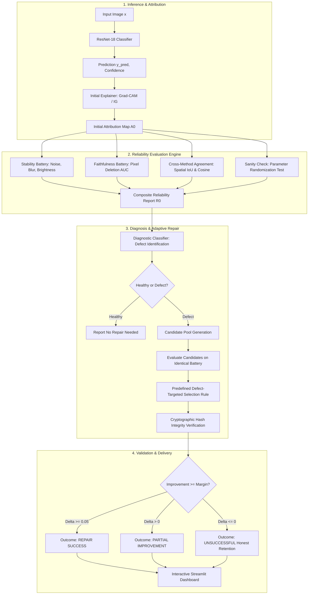

# ExplainRepair 🛡️
### An Adaptive Framework for Detecting, Diagnosing, and Repairing Unreliable AI Explanations

[](https://www.python.org/downloads/)
[](https://pytorch.org/)
[](https://captum.ai/)
[](https://streamlit.io/)
[](https://docs.pytest.org/)

---

## 1. Abstract

Explainable Artificial Intelligence (XAI) algorithms—such as Grad-CAM and Integrated Gradients—are increasingly utilized to justify machine learning decisions in safety-critical computer vision applications. However, existing explanation pipelines operate in an open loop: explanations are generated and displayed without systematic verification of their reliability. Saliency maps can be fragile to imperceptible input perturbations (instability), fail to identify the features causally responsible for model predictions (unfaithfulness), diverge radically across mathematical formulations (disagreement), or persist even after model weights are destroyed (parameter insensitivity).

**ExplainRepair** introduces an adaptive, closed-loop framework that continuously evaluates explanation quality across multiple formal dimensions, automatically diagnoses empirical defect categories, and repairs unreliable explanations through non-invasive candidate exploration. By benchmarking alternative intermediate representations, baselines, and noise-smoothing kernels, ExplainRepair selects superior explanations that resolve diagnosed defects while guaranteeing that underlying model parameters and prediction logits remain 100% unaltered.

---

## 2. Problem Statement & Research Dilemma

Existing XAI literature is characterized by a critical dilemma: **blind trust in visual saliency**.

* **The Saliency Illusion**: Heatmaps that highlight an object may look convincing to humans, yet the model might be predicting the class based on background shortcuts.
* **Perturbation Fragility**: Adding camera sensor noise ($\sigma = 0.05$) can drastically warp Integrated Gradients attributions, despite the model retaining its original prediction with high confidence.
* **Axiomatic Incoherence**: Grad-CAM (activation-based) and Integrated Gradients (gradient-path-based) often point to completely disparate spatial regions for the exact same inference.
* **Insensitivity Defect**: Saliency methods frequently act like edge detectors rather than explaining learned representations (failing parameter randomization tests).

ExplainRepair transitions XAI from **passive visualization** to **active, closed-loop reliability engineering**.

---

## 3. System Architecture



---

## 4. Research Questions (RQs)

* **RQ1 (Stability)**: *How stable are Grad-CAM and Integrated Gradients under controlled, label-preserving input perturbations (Gaussian noise, blur, brightness shifts)?*
* **RQ2 (Faithfulness)**: *How effectively do attributed salient features influence model confidence under progressive feature removal compared to random masking baselines?*
* **RQ3 (Failure Frequency)**: *How frequently do off-the-shelf saliency explanations trigger operational warnings across the reliability dimensions?*
* **RQ4 (Repair Efficacy)**: *Does adaptive candidate selection measurably improve composite reliability scores over initial explanations?*
* **RQ5 (Computational Overhead)**: *What is the execution latency and resource overhead incurred by the closed-loop evaluation and repair pipeline?*

---

## 5. Technology Stack

* **Language**: Python 3.11+
* **Deep Learning Framework**: PyTorch 2.1+, Torchvision 0.29+
* **Hardware Acceleration**: Automatic GPU / Apple Silicon (`mps`) / CPU detection
* **Attribution Algorithms**: Native PyTorch Hooks for Grad-CAM; Captum 0.9+ for Integrated Gradients; SmoothGrad-CAM
* **Data & Numerical Science**: NumPy 2.4+, SciPy 1.17+, Pandas 3.1+, Scikit-Learn 1.9+
* **Visualizations**: Matplotlib 3.11+ (publication-quality Agg backend)
* **Interactive UI**: Streamlit 1.66+
* **Automated Testing**: Pytest 9.2+

---

## 6. Installation & Quickstart

### Prerequisites
* macOS (Apple Silicon or Intel) or Linux / Windows with Python 3.11+ installed.

### 1. Clone & Set Up Environment
```bash
git clone https://github.com/your-username/ExplainRepair.git
cd ExplainRepair

# Create and activate virtual environment
python3.11 -m venv .venv
source .venv/bin/activate

# Upgrade pip and install dependencies
pip install --upgrade pip
pip install -r requirements.txt
```

### 2. Run Automated Test Suite
Verify that all explainer shapes, reliability metrics, and repair guarantees pass:
```bash
pytest tests/ -v
```

### 3. Launch Interactive Streamlit Dashboard
```bash
streamlit run app.py
```
Open [http://localhost:8501](http://localhost:8501) in your browser.

---

## 7. Model Training & Pretrained Weights

The framework uses a ResNet-18 model adapted for CIFAR-10 (replaces 7x7 conv1 and maxpool with 3x3 conv1 and identity pooling to maintain spatial resolution at 32x32).

To train the model from scratch:
```bash
# Standard 3-epoch training on 8,000 samples (takes ~90 seconds on Apple Silicon MPS):
python train.py --epochs 3 --batch-size 128 --train-subset 8000 --val-subset 1500

# Quick start (1 epoch on 2,000 samples):
python train.py --quick
```
Weights are automatically saved to `checkpoints/resnet18_cifar10.pt`, and training curves to `results/training_history.json`.

---

## 8. Reliability Evaluation Engine: Metrics & Formulations

ExplainRepair assesses four independent dimensions, normalizing each to a $[0, 1]$ scale where higher always denotes superior reliability:

### Dimension 1: Explanation Stability
Evaluates attribution invariance across a set of controlled, label-preserving perturbations $p \in P$ (Gaussian noise $\sigma=0.05$, Gaussian blur radius=1.0, brightness jitter):
$$\text{Stability}(x) = \frac{1}{|P|} \sum_{p \in P} \left[ 0.6 \cdot \frac{\cos(A(x), A(x + p)) + 1}{2} + 0.4 \cdot \frac{\rho(A(x), A(x + p)) + 1}{2} \right]$$
* **Score Direction**: $1.0$ (perfect invariance) $\to 0.0$ (drastic instability).

### Dimension 2: Causal Faithfulness (Pixel Deletion AUC)
Ranks all pixels by attribution magnitude in descending order and progressively masks top-$k\%$ features ($0\%, 5\%, 10\%, 20\%, 35\%, 50\%, 70\%, 90\%$), calculating target class confidence $p_{\text{attr}}(k)$ compared to an averaged multi-run random baseline $p_{\text{rand}}(k)$:
$$\Delta_{\text{faith}} = \text{AUC}_{\text{rand}} - \text{AUC}_{\text{attr}}$$
$$\text{Score}_{\text{faith}} = \text{clip}\left(0.50 + \frac{\Delta_{\text{faith}}}{2 \cdot \max(0.10, \text{AUC}_{\text{rand}})}, 0.0, 1.0\right)$$
* **Interpretation**: When masking attributed pixels degrades confidence faster than random masking, $\text{AUC}_{\text{attr}} < \text{AUC}_{\text{rand}} \implies \text{Score}_{\text{faith}} > 0.50$.

### Dimension 3: Cross-Method Agreement
Compares Grad-CAM and Integrated Gradients after normalizing to identical grids:
$$\text{Agreement}(x) = 0.40 \cdot \frac{\cos(A_1, A_2) + 1}{2} + 0.30 \cdot \frac{\rho(A_1, A_2) + 1}{2} + 0.30 \cdot \text{IoU}_{\text{top20\%}}(A_1, A_2)$$

### Dimension 4: Model Sensitivity Sanity Check (Adebayo et al., 2018)
Randomizes parameters of the target layer and all cascading subsequent layers up to the classification head (`layer3` $\to$ `layer4` $\to$ `fc`) on an isolated deepcopy of the model, restoring original model weights unconditionally in a `finally` block:
$$\text{Score}_{\text{sanity}} = 1.0 - \max(0.0, \cos(A_{\text{trained}}, A_{\text{randomized}}))$$
* **Interpretation**: An explanation that collapses upon weight randomization passes ($\text{Score} \approx 1.0$). An explanation that persists unchanged fails ($\text{Score} \approx 0.0$), indicating reliance on input edge artifacts.

### Dimension 5: Decoupled Independent Validation (Insertion Causal Metric)
To avoid circularity where candidate selection and validation share identical deletion curves, candidate selection optimizes on deletion drop + stability, whereas independent validation is performed on **progressive feature insertion** (Petsiuk et al., 2018; Samek et al., 2016). Starting from a Gaussian-blurred uninformative baseline, salient features are progressively restored. The system evaluates whether target class confidence recovers faster than random features ($\text{AUC}_{\text{ins}} > \text{AUC}_{\text{rand}}$). If selection score improves but insertion does not, the repair is honestly classified as `SELECTION_IMPROVED_ONLY`.

---

## 9. Closed-Loop Adaptive Repair Algorithm

```python
def adaptive_repair(model, image, initial_explainer, candidate_pool, thresholds):
    # Step 0: Cryptographic fingerprint of model parameters
    initial_hash = sha256_hash(model.parameters())
    
    # Step 1 & 2: Generate and evaluate initial explanation
    A_0 = initial_explainer.attribute(image)
    R_0 = evaluate_reliability(initial_explainer, image)
    
    # Step 3: Diagnose failure modes
    defects = diagnose_failures(R_0, thresholds)
    if not defects:
        return RepairResult(status="NO_REPAIR_NEEDED", explainer=initial_explainer)
        
    # Step 4 & 5: Evaluate alternative candidate pool (selection metric: deletion + stability)
    best_candidate = None
    best_score = R_0.composite_score
    
    for candidate in candidate_pool:
        R_c = evaluate_reliability(candidate, image)
        
        # Defect-specific eligibility filtering
        if "INSTABILITY" in defects and R_c.stability < R_0.stability:
            continue
        if "UNFAITHFUL" in defects and R_c.faithfulness < R_0.faithfulness:
            continue
        if "INSENSITIVITY" in defects and R_c.sanity_check.failed:
            continue
            
        if R_c.composite_score > best_score:
            best_score = R_c.composite_score
            best_candidate = candidate
            
    # Step 6: Decoupled independent validation via Feature Insertion AUC
    V_initial = evaluate_insertion(initial_explainer, image)
    V_selected = evaluate_insertion(best_candidate, image)
    delta_val = V_selected.score - V_initial.score
    
    # Step 7: Verify non-invasive guarantee
    assert sha256_hash(model.parameters()) == initial_hash, "Integrity violation!"
    
    # Step 8: Honest outcome reporting
    delta_sel = best_score - R_0.composite_score
    if delta_sel >= thresholds.min_improvement_margin:
        outcome = "VALIDATED_IMPROVEMENT" if delta_val > 0 else "SELECTION_IMPROVED_ONLY"
    elif delta_sel > 0.0:
        outcome = "PARTIAL_IMPROVEMENT"
    else:
        outcome = "UNSUCCESSFUL"
    return RepairResult(outcome=outcome, selected=best_candidate, delta_sel=delta_sel, delta_val=delta_val)
```

---

## 10. Actual Experimental Results (Saved CIFAR-10 Benchmark)

Empirical results from the 10-sample benchmark (`results/experiments_summary.json` and `results/experiments_raw.csv`):

| Metric / Attribute | Grad-CAM (Layer 4) | Integrated Gradients |
| :--- | :--- | :--- |
| **Mean Composite Reliability** | 0.715 ± 0.043 (SEM) | 0.676 ± 0.025 (SEM) |
| **Perturbation Stability ($\sigma=0.05$)** | 0.999 | 0.993 |
| **Faithfulness Score (Deletion AUC)** | 0.580 | 0.562 |
| **Average Attribution Runtime** | 0.707 s / image | 1.183 s / image |

### Repair Cohort Accounting & Rates
All rates are calculated using their explicitly defined denominators:
* **Total Evaluated Samples**: 10
* **Samples Requiring Repair**: 7 (3 healthy samples satisfied criteria without repair)
* **Actual Repair Attempts**: 7
* **Candidate Selection Score Improved**: 4 samples (**57.1%** of actual attempts; denominator: `actual_repair_attempts`)
* **Independent Validation Passed**: 2 samples (**28.6%** of actual attempts; denominator: `actual_repair_attempts`)
* **Partial Improvement**: 1 sample
* **Unsuccessful Attempts**: 2 samples (honestly reported)
* **Population Repair Rate**: **40.0%** (4 / 10 total evaluated samples; denominator: `total_samples_evaluated`)
* **Mean Selection Improvement ($\Delta$)**: +0.045
* **Mean Validation Improvement ($\Delta$)**: +0.014
* **Average Repair Overhead**: 8.08 s / sample

### Calibrated Stress-Test Spectrum (CIFAR-10)
| Noise Std Dev ($\sigma$) | Cosine Similarity | Spearman Rank Correlation |
| :---: | :---: | :---: |
| 0.02 | 1.000 | 0.9998 |
| 0.05 | 0.9999 | 0.9991 |
| 0.10 | 0.9985 | 0.9923 |
| 0.20 | 0.9936 | 0.9739 |
| 0.35 | 0.9580 | 0.8559 |

---

## 11. Interactive Streamlit Dashboard

Launch the application:
```bash
streamlit run app.py
```
Open `http://localhost:8501`.

### Featured Showcase: Explanation Stress Test Lab 🔬
The dashboard includes an interactive **Explanation Stress Test Lab** designed for live project demonstration:
1. **Sample Selection**: Choose from 10 pre-loaded CIFAR-10 classes or upload a custom image.
2. **Interactive Perturbations**: Adjust Gaussian noise ($\sigma \in [0.0, 0.40]$), blur radius ($r \in [0.0, 3.0]$), and brightness ($\beta \in [0.5, 1.8]$).
3. **Visual Matrix**: Side-by-side comparison of original vs. perturbed images alongside their corresponding Grad-CAM and Integrated Gradients heatmaps.
4. **Model Invariance Check**: Confirms whether the model prediction remained invariant under perturbation while explanations shifted.
5. **Diagnosis Panel**: Explains detected failure modes (saliency instability, unfaithfulness, cross-method disagreement).
6. **Closed-Loop Repair Panel**: Evaluates candidate pool (Grad-CAM Layer 3, SmoothGrad, IG blur/white baselines), displays before-and-after heatmaps, and provides independent insertion validation results.
7. **Non-Invasive Model Guarantee**: Displays SHA-256 weight hash invariance verifying that the neural network was never modified.

---

## 12. Known Limitations & Threats to Validity

1. **Resolution Constraints**: CIFAR-10 consists of $32 \times 32$ images. Coarse spatial pooling at `layer4` ($4 \times 4$ activation grid) buffers low-magnitude noise; higher perturbation intensities ($\sigma \ge 0.20$) are required to challenge stability.
2. **Proxy Metric Limitations**: Both pixel deletion and insertion curves rely on synthetic baselines (blur/constant masking) which may induce mild out-of-distribution artifacts. Insertion provides an independent corroborative check but does not constitute ground-truth proof.
3. **Non-Invasive Architecture**: ExplainRepair fixes explanation algorithms, not model representations. If the model itself relies on a spurious correlation, a faithful explanation should honestly highlight that shortcut rather than masking it.

---

## 13. References

* **Grad-CAM**: Selvaraju, R. R., et al. "Grad-CAM: Visual Explanations from Deep Networks via Gradient-based Localization." *ICCV*, 2017.
* **Integrated Gradients**: Sundararajan, M., Taly, A., & Yan, Q. "Axiomatic Attribution for Deep Networks." *ICML*, 2017.
* **SmoothGrad**: Smilkov, D., et al. "SmoothGrad: removing noise by adding noise." *arXiv:1706.03825*, 2017.
* **Sanity Checks**: Adebayo, J., et al. "Sanity Checks for Saliency Maps." *NeurIPS*, 2018.
* **Insertion Metric**: Petsiuk, V., Das, A., & Saenko, K. "RISE: Randomized Input Sampling for Explanation of Black-box Models." *BMVC*, 2018.

