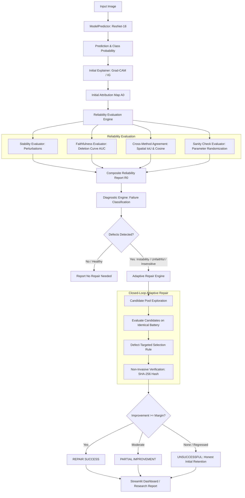

# ExplainRepair: Technical Architecture & System Guide

This document provides a comprehensive technical breakdown of **ExplainRepair**, detailing the role of each source file, architectural relationships, and a conceptual guide to the adaptive repair algorithm designed for academic review and defense.

---

## 1. High-Level Architecture Overview

---

## 2. Source Code Modular Decomposition

### Core Configuration
* [config.py](file:///Users/karthikreddy/Desktop/ExplainRepair/config.py):
  Central nervous system containing typed dataclasses (`ModelConfig`, `ExplainerConfig`, `ReliabilityConfig`, `RepairConfig`, `ExperimentConfig`, `AppConfig`). Centralizes all hyperparameter defaults, operational thresholds, loss weights, and directory paths, eliminating magic numbers.

### Model Layer (`models/`)
* [models/model.py](file:///Users/karthikreddy/Desktop/ExplainRepair/models/model.py):
  Implements `ResNet18CIFAR10`. Adapts standard PyTorch ResNet-18 for 32x32 image dimensions by replacing the aggressive 7x7 `conv1` (stride 2) and `maxpool` with a 3x3 `conv1` (stride 1) and identity pooling, preserving spatial resolution. Also houses the full training loop with loss tracking, accuracy logging, and checkpoint saving.
* [models/predictor.py](file:///Users/karthikreddy/Desktop/ExplainRepair/models/predictor.py):
  Inference wrapper. Handles image preprocessing, automatic accelerator detection (`mps`, `cuda`, `cpu`), forward pass evaluation, softmax probability computation, and top-5 ranking into structured `PredictionResult` objects.

### Explanation Layer (`explainers/`)
* [explainers/base_explainer.py](file:///Users/karthikreddy/Desktop/ExplainRepair/explainers/base_explainer.py):
  Abstract base class defining the contract for all attribution methods (`attribute()`, `explain()`, execution time tracking, and metadata introspection).
* [explainers/gradcam_explainer.py](file:///Users/karthikreddy/Desktop/ExplainRepair/explainers/gradcam_explainer.py):
  Native PyTorch hook implementation of Grad-CAM (Selvaraju et al., 2017) and SmoothGrad-CAM. Safely manages forward and backward hooks with deterministic lifecycle cleanup in `finally:` blocks to prevent memory leaks.
* [explainers/integrated_gradients_explainer.py](file:///Users/karthikreddy/Desktop/ExplainRepair/explainers/integrated_gradients_explainer.py):
  Axiomatic path-attribution implementation (Sundararajan et al., 2017). Supports configurable baselines (black, white, blur, random noise), integration step counts, and convergence completeness diagnostics. Includes Captum binding and a native Riemann-sum fallback.
* [explainers/explainer_factory.py](file:///Users/karthikreddy/Desktop/ExplainRepair/explainers/explainer_factory.py):
  Factory module instantiating parameterized explainer objects from configuration dictionaries.

### Reliability Layer (`reliability/`)
* [reliability/stability.py](file:///Users/karthikreddy/Desktop/ExplainRepair/reliability/stability.py):
  Measures explanation sensitivity under small controlled perturbations (Gaussian noise, Gaussian blur, brightness jitter) using normalized cosine similarity and Spearman rank correlation. Crucially verifies **prediction preservation** so an explainer is not penalized if the model legitimately changed its prediction.
* [reliability/faithfulness.py](file:///Users/karthikreddy/Desktop/ExplainRepair/reliability/faithfulness.py):
  Implements causal feature deletion curves. Progressively masks top-$k\%$ salient pixels and tracks the drop in target class probability compared to a randomized masking baseline. Quantifies faithfulness via Area Under the Deletion Curve (AUC).
* [reliability/agreement.py](file:///Users/karthikreddy/Desktop/ExplainRepair/reliability/agreement.py):
  Evaluates consensus between distinct explanation paradigms (e.g., activation-based Grad-CAM vs. path-gradient Integrated Gradients) using spatial Top-20% Intersection over Union (IoU), Cosine similarity, and Spearman rank correlation.
* [reliability/sanity_checks.py](file:///Users/karthikreddy/Desktop/ExplainRepair/reliability/sanity_checks.py):
  Implements parameter randomization sanity checks (Adebayo et al., 2018). Evaluates whether attributions collapse when model weights are randomized, detecting edge-detector artifacts. Uses an isolated deepcopy to ensure original model weights remain untouched.
* [reliability/reliability_evaluator.py](file:///Users/karthikreddy/Desktop/ExplainRepair/reliability/reliability_evaluator.py):
  Synthesizes the four independent dimensions into a unified `[0, 1]` composite score, applies thresholds, and produces structured failure diagnoses.

### Repair Layer (`repair/`)
* [repair/diagnosis.py](file:///Users/karthikreddy/Desktop/ExplainRepair/repair/diagnosis.py):
  Classifies empirical failures into distinct defect categories (`INSTABILITY`, `UNFAITHFUL`, `CROSS_METHOD_DISAGREEMENT`, `MODEL_INSENSITIVITY`) and maps them to remediation candidates.
* [repair/validation.py](file:///Users/karthikreddy/Desktop/ExplainRepair/repair/validation.py):
  Enforces experimental integrity. Uses cryptographic SHA-256 parameter fingerprints and prediction checks to guarantee that model weights and predictions are completely unaltered during explanation repair.
* [repair/repair_engine.py](file:///Users/karthikreddy/Desktop/ExplainRepair/repair/repair_engine.py):
  Orchestrates closed-loop repair: generates alternative candidates, evaluates them on the identical protocol, applies defect-specific selection rules, and honestly reports outcomes (`SUCCESS`, `PARTIAL_IMPROVEMENT`, `UNSUCCESSFUL`, or `NO_REPAIR_NEEDED`).

### Experiments & Utilities (`experiments/`, `utils/`)
* [experiments/run_experiments.py](file:///Users/karthikreddy/Desktop/ExplainRepair/experiments/run_experiments.py):
  Reproducible pipeline executing Experiments A through E on CIFAR-10 test sets and saving raw CSV and summary JSON metrics.
* [experiments/perturbation_tests.py](file:///Users/karthikreddy/Desktop/ExplainRepair/experiments/perturbation_tests.py):
  Noise spectrum stress tests across ascending perturbation magnitudes.
* [experiments/generate_report.py](file:///Users/karthikreddy/Desktop/ExplainRepair/experiments/generate_report.py):
  Generates publication figures (`baseline_comparison.png`, `repair_distribution.png`, `repair_trajectories.png`).
* [utils/image_utils.py](file:///Users/karthikreddy/Desktop/ExplainRepair/utils/image_utils.py), [utils/metrics.py](file:///Users/karthikreddy/Desktop/ExplainRepair/utils/metrics.py), [utils/visualization.py](file:///Users/karthikreddy/Desktop/ExplainRepair/utils/visualization.py):
  Preprocessing, colormap blending, statistical functions (AUC, Cosine, IoU, Spearman), and matplotlib figure generators.
* [app.py](file:///Users/karthikreddy/Desktop/ExplainRepair/app.py):
  Interactive 5-page Streamlit dashboard providing a professional research interface.

---

## 3. Defense Guide: The Adaptive Repair Algorithm Explained Simply

When defending this project during a faculty evaluation or project viva, explain the concept using this dialogue:

> **Question:** *"What is the core contribution of ExplainRepair over existing XAI libraries like Captum or TorchCAM?"*
>
> **Answer:** 
> "Most existing XAI tools operate in an **open loop**: you pass an image into Grad-CAM or Integrated Gradients, and it produces a heatmap. The user has no way of knowing whether that heatmap is faithful to the model, whether it is brittle to slight camera noise, or whether it passes sanity checks.
> 
> **ExplainRepair transforms explanation generation into a closed-loop engineering system**:
> 1. It **tests** the explanation across four rigorous dimensions (Stability, Faithfulness, Agreement, and Sanity).
> 2. It **diagnoses** specific failure modes (e.g., 'This explanation is unstable under small noise' or 'Deleting top features does not lower confidence').
> 3. It **adapts** by exploring alternative configurations (such as different intermediate convolutional layers, baselines, or noise smoothing).
> 4. It **selects** an improved explanation only when measurable empirical metrics prove the defect is resolved.
> 5. Most importantly, it is **non-invasive**: it repairs the *explanation*, not by retraining or tampering with the model weights, and it **honestly reports failures** when no candidate achieves the required threshold."

---

## 4. Key Mathematical Formulations

### 1. Stability Metric (Invariance under Perturbation)
$$\text{Stability}(x) = \frac{1}{|P|} \sum_{p \in P} \left[ \alpha \cdot \frac{\cos(A(x), A(x + p)) + 1}{2} + (1 - \alpha) \cdot \frac{\rho_{\text{spearman}}(A(x), A(x + p)) + 1}{2} \right]$$
Where $P$ is the set of label-preserving perturbations, $\cos$ is cosine similarity, and $\rho_{\text{spearman}}$ is rank correlation.

### 2. Faithfulness Metric (Area Under Deletion Curve)
$$\Delta_{\text{faith}} = \text{AUC}_{\text{random\_deletion}} - \text{AUC}_{\text{attribution\_deletion}}$$
$$\text{Score}_{\text{faith}} = \text{clip}\left(0.50 + \frac{\Delta_{\text{faith}}}{2 \cdot \max(0.10, \text{AUC}_{\text{random}})}, 0.0, 1.0\right)$$
A faithful explanation produces a rapid drop in model confidence when top features are masked, resulting in $\text{AUC}_{\text{attr}} < \text{AUC}_{\text{random}}$ and a score $> 0.50$.

### 3. Model Parameter Sanity Check
$$\text{Score}_{\text{sanity}} = 1.0 - \max\left(0, \cos(A_{\text{trained}}(x), A_{\text{randomized}}(x))\right)$$
If the attribution map completely changes when model weights are randomized, $\cos \approx 0 \implies \text{Score}_{\text{sanity}} \approx 1.0$ (Passed). If it persists unchanged, $\cos \approx 1.0 \implies \text{Score}_{\text{sanity}} \approx 0.0$ (Failed).
